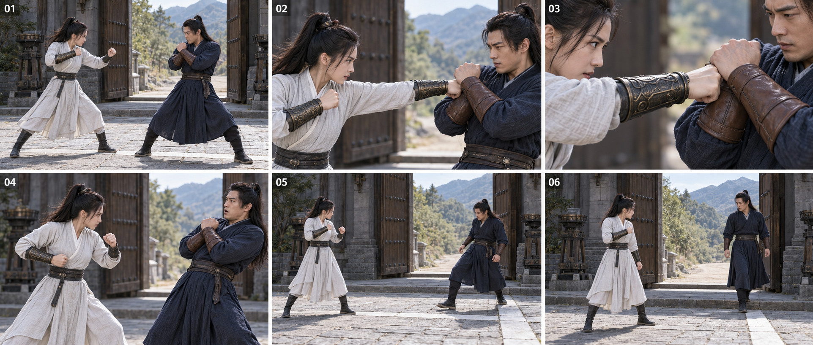
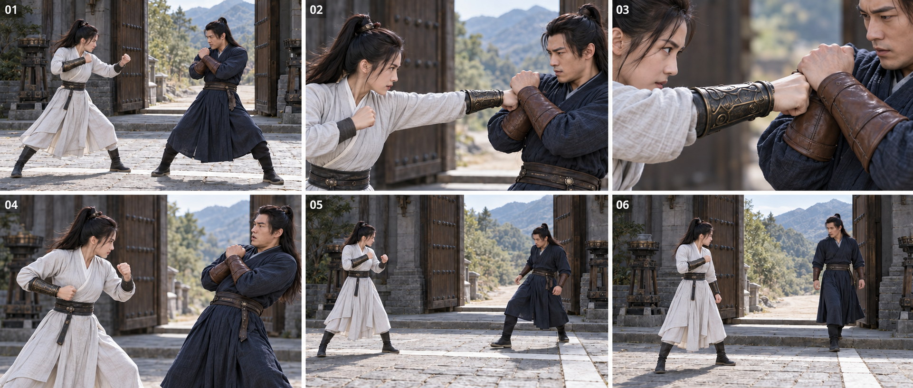
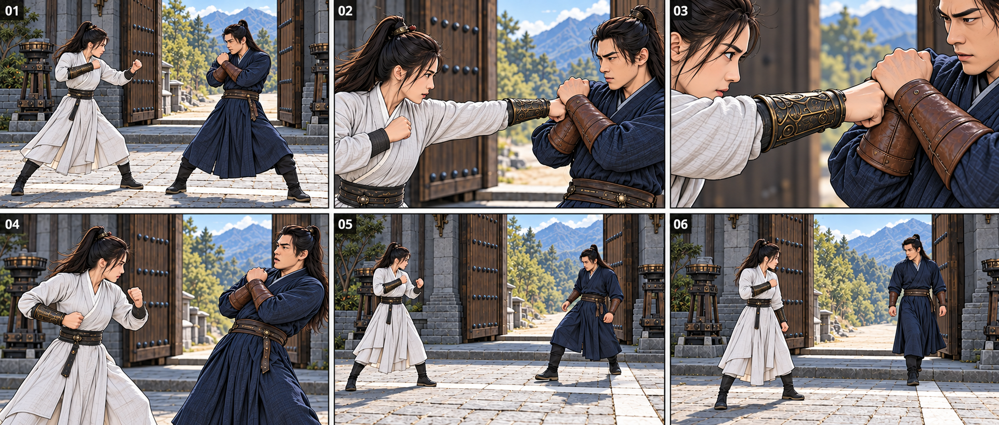

# 三套 Skill 联合可视复现｜REPRO-JOINT-20261018-01

记录日期：2026-10-18（Asia/Shanghai）。这是当天既有审计的后续实际图像验证，不重做搜索、不改12:50原报告的历史事实。用户指令授权本次静态小样与治理更新；未授权把新图记为已认可。
候选：CUT-CONTINUITY-20261018-S。现行影视/漫画/资产均1.01。

## 1. 结论
实际完成三次内置图像调用：真人初版→针对护腕和石条修订→引用修订图转漫画。已交付可检查图和完整提示词。结果为部分静态验证，整体复现票仍未通过，候选保持candidate。无新技巧/资讯搜索；今日原3+1记录不改；本次0分0罚、不新增待核奖励。
这次检查的是最小8秒片段设计与图像输出，不是原30秒视频重制，也不是Seedance运行。

## 2. 测试问题、来源与设置
问题：换景别时同一次接触是否延续；同一套图能否同时暴露叙事/机位与人物、护腕、场景连续性问题。
剧情依据：已获认可的《退一步》存档 skills/script-video-shot-director/references/cases/2026-10-18-stepback-continuous.md（baseline f1c51f75970eebc7bfc58416f5b8c25b8fec277e）。本次取其中单次右拳、防守、后退、让路，压缩为8秒规划；其余对白与发光不在本次测试，未覆写原案例。
原角色图不在当前会话，故采用明确标注的新测试形象；原漫画未提供，不冒充漫画原作解析。
保持：同一剧情、女左男右、同侧机位、灰白/深蓝服装、仅女右臂铜护腕、门与石条。真人与漫画的变化项为画风；漫画版从film-v2引用衍生，非独立实验。
工具：image_gen.imagegen；三次transparent_background=false；修订及漫画转换均num_last_images_to_include=1。精确底层模型、种子未暴露。没有公司Seedance入口、视频、音频或目标参数。
工具要求的单格16:9未落实：实际整图film-v1为1923×818，film-v2和comic-v1为1922×818；六格单格约1.57:1，非16:9。数字01—06可辨。
时效：实际出图日在2026-10-18；本次未取得候选整体成功验证日期；原平台/工作流复审日期不改为通过日期。

## 3. 证据与三套覆盖
|主张|实际证据|检查结论与缺口|
|---|---|---|
|影视跨景别可检查同一接触状态|film-v2的02中景与03近景|女左男右、接触点与服装总体对应；03不能独立追溯完整右肩，具体腕角/解剖手别不作精确通过；视频无重演/无跳帧未验证|
|漫画可复用共有分镜设计|comic-v1六格同构图|图序和事件可比较；这是有引用的换画风，不能作为独立复现或证明原漫画格序/气泡/对白识别|
|资产可在镜内同步受检|film-v1的02与film-v2的02|原图女主非出拳臂误有铜护腕；修订后该臂为布料，数量错误已去除；未证所有手别/道具精细细节都正确|
|场景与足部证据足够明确|01、05、06的脚/石条/门|未通过：石条前后、跨线落脚及男主让路姿态没有清晰闭环，门槛层次又可能干扰判断|
|足以作为最终视频复现|只有静态三图|未通过：无速度、时序、运镜、口型、音效或目标模型实际输出|
三图有明确同源链，不是三项独立证据。不新增一手研究，不把同一图复制到三套算三次成功。

## 4. 实跑、反例与修订
- Call1：完整输入见generation-prompts.md。产物film-v1.png；观察到02出现第二个铜护腕。状态未通过，永久保留。
- Call2：引用film-v1，仅要求修护腕与石条/足部。产物film-v2.png；02非出拳臂铜护腕已去除；石条与落脚仍未充分满足，06让路不明显，部分通过。
- Call3：引用film-v2做漫画画风转换，明确不重新解释空间。产物comic-v1.png；保留共同构图，也继承石条/让路缺口。是依赖性衍生适配。
预期：同一拳不重演、同一右臂护腕、切点状态明确、退步跨过同一条线、最后通路打开、单格16:9。
实际：已有真实六格与修订，护腕数量修复；空间/足部/让路/画幅仍未通过，完整手别判断也不充分。未实际播放或生成动态结果。
后续最小修正方向：先固定门与唯一石条的明确地面平面关系，再单独设计05/06足部和让路姿态；若再测严格画幅，用独立16:9单镜生成而不是依赖拼图。此为后续设计建议，未执行，不把建议当效果保证。不在本轮反复抽样挑成功掩盖失败。
第三次反证搜索沿用原审计，未追加搜索；本轮新增的是出图暴露的反例，不篡改原查询。

## 5. 七问逐答
1. 最可能错处：把可读静态状态当成视频动作顺畅，或把提示词写了“右”当作解剖手别已核实。实际检查保留未测。
2. 过时/替代：不改变原理论时效；简单单镜/更少镜头仍是可比替代，无证据称六镜更优。
3. 同源互抄：漫画直接引用真人修订图，修订引用初版，非三份独立验证。
4. 版本/付费/地区：仅能确认内置工具调用成功；底层模型和Seedance构建、付费/地区条件未核实，不编造。
5. 更简单方案：共用一套图先查叙事与资产，漫画只在需要时派生；不强制每个候选画两种风格或三份成品。
6. 失败点：第二护腕、门/石条/足部空间、让路姿态、非16:9、近景解剖手别缺证据；其中仅第二护腕数量已修复。
7. 是否凑数：不新增候选/搜索/积分，不借三张图凑三次独立复现或升版；失败原件和未通过项保留。

## 6. 状态与三票
候选candidate不变。证据票：原AI迁移效果证据缺口未补齐；复现票：已执行静态部分，但关键项仍失败且动态未测，整体未通过；人类票：尚未收到对本批图/方法的认可。
分项：影视静态设计部分可评估、动态未测；漫画共同分镜/画风可评估、原作解析未测；资产镜内一致性部分可评估、完整基础资产与空间几何未通过/未测。没有把原案例的人类认可借给本批新图。
本次没有新原漫画，不验证漫画读序/气泡归属；没有独立基础人物/无角色场景四视图/单件道具，不声称全套资产Skill通过。旧四项改进仍open。

## 7. 保存、版本与回滚
三套均1.01，本次用户授权新增“先交真实分镜图与提示词，再由人类评估”的治理交付规则，接入各套入口/联动规则/审计模板/检查契约；不发布新技术效果、不改version.json、余额或自动任务。
基线f1c51f75970eebc7bfc58416f5b8c25b8fec277e；备份分支backup/pre-joint-reproduction-20261018已读回确认；本地完整基线恢复副本在当前任务work/joint-reproduction-repo的Git对象中，before.json保存全部被修改文件原文。
本目录内图片、完整实际输入、中文逐镜词、清单、报告与run记录经同一PR保存；实际PR/head/main回读以最终会话回执和PR永久记录为准，本文不提前声称核验成功。GitHub main为唯一可信源，旧云端不操作。
入口、联动、模板、契约按三套分别接入相同治理要求；适配检查仍保留各套专有能力与验证边界。

## 8. 可追溯记录
无新增网络搜索；既有3次技巧+1次资讯仍在../query-ledger.json，原来源快照和原报告不改写。
generation-prompts.md逐字保存三次实际输入及引用链；shot-prompts.md是中文可复用逐镜设计；manifest.json列本目录文件的SHA-256、字节数、图片实际宽高和Git blob SHA；run.json记录分项状态。
备份before.json含旧17文件完整文本。PR前核对差异，合并后独立读取main，逐文件内容或Git blob SHA比对。首次检查发现registry/latest.json为较早快照，且Windows检出带CRLF；保留原清单至registry/manifests/pre-joint-reproduction-20261018.json，用Git LF字节生成当前完整三套清单，再运行tools/verify_backup.py。结果在最终回执如实列出，不把完整性检查当图像质量或人类认可。

## 可直接查看的图片
### 真人初版（保留失败）

### 真人修订版

### 漫画画风衍生版

