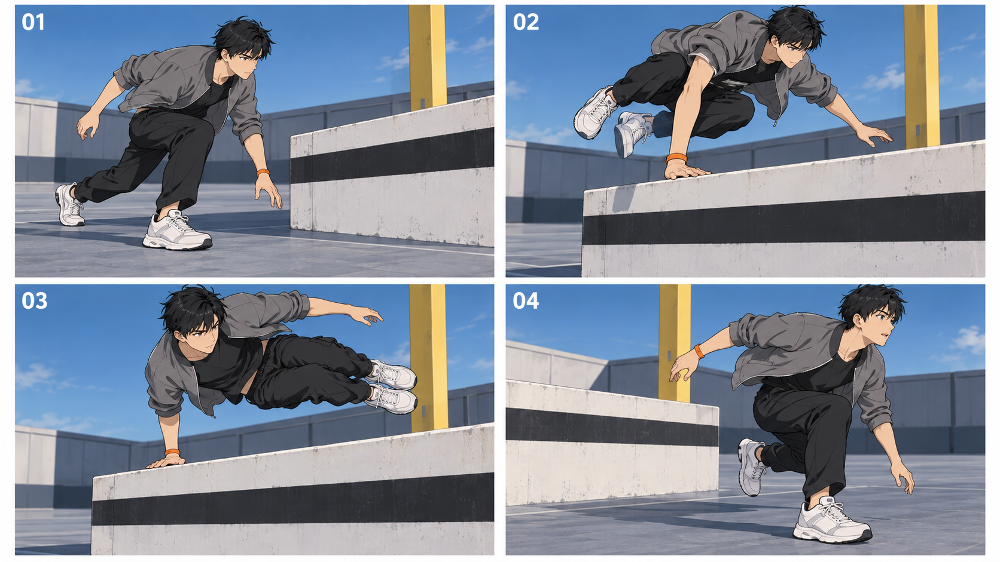

# 实际复现结果

run_id REPRO-POSE-SPACING-20261020-01；关联POSE-SPACING-20261020-S。
实际生成1张四状态联络单，实际图像工具调用1次；未生成视频，未运行论文评测器。首轮原图保留，不挑成功样张。

## 环境、材料与过程

内置image_gen.imagegen，新图，无输入参考，透明背景关闭；精确底层模型、种子、采样步数未暴露。
实际图片1672×941、PNG；每格近似16:9，不冒称精确导出。完整实际输入在generation-prompts.md，规划状态和逐状态词在shot-prompts.md，哈希见run.json/manifest.json。
先确定单一成年测试形象和墙/柱空间锚点，再规划预备→右掌支撑→收膝腾空→着地四状态，再出图，最后先查身份空间、再查动作表演。图片不输入用户原漫画，不上传私有原页。

对标只取用户先前提供漫画页中可见的二维墨线、动作姿态反差和身体腾空特征；已实际看原尺寸页，但不由此更改该漫画剧情、人物或原作设定。本轮新测试故事仅为“单手越一堵矮墙”，不冒充原格改编成功。

## 预期与实际

|检查|实际现象|结果|
|---|---|---|
|人物身份/服装/腕带|四格脸型发型整体相近，灰夹克黑裤白鞋一致，橙带随支撑手保留；非中性多视资产检验|visible_part_provisionally_passed|
|人物/肢体数量|可见每格单人；未见明显多臂多腿，不推定遮挡处所有解剖正确|visible_part_provisionally_passed|
|手掌支撑|02/03橙带侧手掌均可见贴墙顶，身体离地；静态接触可读，不证明连续受力|static_passed|
|腾空越障姿态|02收膝，03身体侧倾、双脚离地，明显区别跑姿|static_passed|
|场景锚点|四格均有黑带墙/黄柱；摄影机跟随可能解释位置变化，缺俯视几何及连续过渡|partial|
|远侧落地拓扑|04墙端与人物同现，不能排除绕墙端或落回近侧的读法；02/03到04的空间连接不可证|not_passed|
|表情差异|01–03神态仍相近，04张口提供变化；不足以满足四种鲜明表演|not_passed|
|二维风格|有二维墨线与动画外观，但地面纹理和部分渐变比目标更写实，不宣称严格平涂达标|partial|
|画幅与裁切|整张1672×941；四格约16:9，未分别导出精确画幅；人物头手脚与支点均可读|partial|
|速度、运镜、受力时序|只有静态图，未生成视频、未核音轨，规划秒数不是实际执行|not_tested|

整体结论：静态支撑与腾空姿态可读；远侧落点仍有歧义，前3格表情变化不足，未达到设计全部预期。不能给整体复现票，更不能称“速度感已经改善”。

## 失败条件与下一步最小修正

触发失败/未通过：不能辨认越墙远侧落点，表情目标未清楚区分。时间非均匀是否被执行、接触持续性、跟镜连续、动态身份和音效均未测。
下一次应先画可检查的简洁俯视几何，明确墙近/远侧和起落区，再针对04落点修订；表情应增加可见眉眼/口型/呼吸差异。修图不等于速度验证，本次不执行第二次出图。
动态最小复现须完成实际目标模型卡，修正相同空间输入，在同一可比环境做均匀/非均匀阶段对照并看真实视频；不依赖一张四格图自动成为四个时序关键帧。

## 四项既有待改进的落实边界

|问题|本次安排/不适用原因|结果|
|---|---|---|
|IMP-20261016-01关键线索不醒目|S01 0–0.7秒以墙顶支点作为动作信息，02用橙腕带突出支撑手；本测试没有手表，不加无关道具|静态手/支点可读；动机和视频读取时间未测，open|
|IMP-20261016-02焦点与视线引导|S01由墙顶→支撑手→腾空髋脚→落点；主体占比和橙带引导，不假称实际拉焦|01/02可读，04空间未过；视频注意力迁移未测，open|
|IMP-20261016-03镜头覆盖/机位反转|隔离单次越障故用同侧低三分之四中全景；不强加无叙事任务的反打/特写，不作为完整打戏导演覆盖范例|静态姿态可读，不证明复杂打斗覆盖或无越轴，open|
|IMP-20261016-04结尾情绪|4秒研究无独立剧情结尾；04设计落地后吐气放松作为反应，未做完整情绪铺垫片|04口型有变化，整体表演不足；无新故事成片/人类评价，open|

三套分别结论：影视静态姿态部分通过、空间未过、视频未测；漫画共有状态阅读部分可读，未验证原作格序/气泡/剧情忠实；资产可见服装/数量暂通过，中性多视和场景四视几何未测。所有效果限该图，均不提升候选票或关闭open项。
