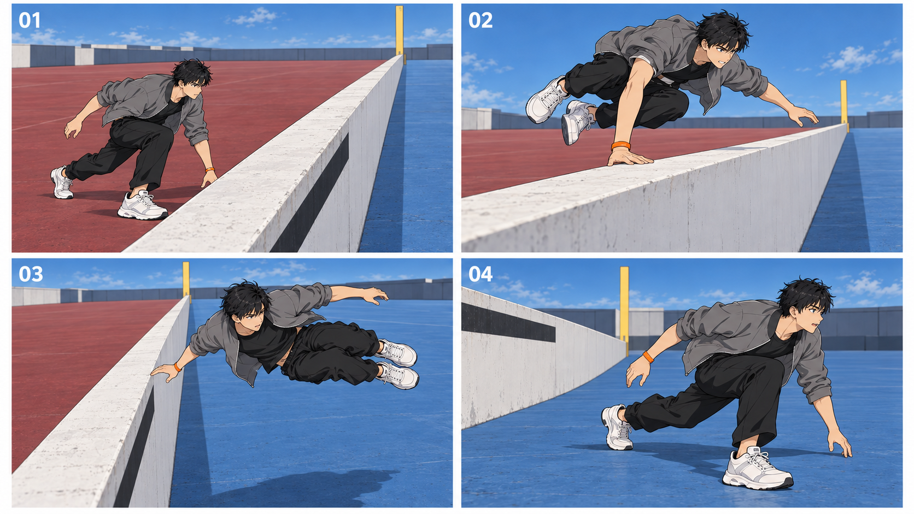

# 2026-10-21 每日学习审计

## 1. 当日结论
AUDIT-20261021-01，Asia/Shanghai，手动当日学习。真实技巧3/3、资讯1/1、额外0；静态图1次、视频0次。固定空间参照让本次越墙两侧更清楚，但黑条所属面/延续、离手间隙、机位表达仍失败。证据不足，今日不入库。
已到账/可用余额9不变；完整空手+3与新S来源+1合计+4仅拟记周五待核，本日无人类数字奖惩。没有明确目标入口的直接反证，不拟反证+2。

## 2. 候选信息与时效
SPATIAL-ANCHORS-20261021-S：固定世界空间锚点与跨机位状态核对。主归影视，漫画适配已知原格间补动作，资产适配同一场景不同视角。与既有空间/状态规则重合93.75%（步骤75%、场景100%、结果100%、限制100%），仅现有Skill迭代。测试形象承接昨天样张，不冒充漫画原脸。
目标静态工具image_gen.imagegen；后端型号/seed不暴露。用户视频模型此前提Seedance2.0，实际当前入口/档位/模式未知；不编规格，不交正式视频提示词，不复用昨日Veo核验卡。LIFT仅为边界研究，未安装/未切换项目。

|ID|标题/作者|发表日|级别|原始链接|
|---|---|---|---|---|
|S1|Layout & Final Layout / Walt Disney Animation Studios|未知|S|https://www.disneyanimation.com/process/layout/|
|S2|Animation Layout: Layout Support Material / Mike S. Fowler|2003-09-19|S|https://www.awn.com/animationworld/animation-layout-layout-support-material|
|S3|Continuity Editing for 3D Animation / Quentin Galvane, Remi Ronfard, Christophe Lino, Marc Christie|未知|S|https://team.inria.fr/imagine/files/2014/11/continuitystyle.pdf|
|S4|LIFT: Layout-In-Future Video Generation under Large Viewpoint Change via On-Policy Self-Distillation / Shengxiang Ji et al.|2026-09-29|S|https://arxiv.org/html/2609.38146v1|
|S4b|LIFT author repository / jsxzs / Shengxiang Ji et al.|未知|S|https://github.com/jsxzs/LIFT|
|S5|Where to look at the movies: Analyzing visual attention to understand movie editing / Alexandre Bruckert, Marc Christie, Olivier Le Meur|2022-08-24|S|https://link.springer.com/article/10.3758/s13428-022-01949-7|
|N1|Vertex AI release notes — Agent Platform Workbench 20261018.00_p0 / Google Cloud|2026-10-19|S|https://docs.cloud.google.com/vertex-ai/docs/release-notes|

核对日期2026-10-21；方法工作流6个月候选复审2027-04-21，平台资料保守30天2026-11-20；正式视频制作仍按当天/切换门禁重新核验。基础理论无固定到期。最后完整真实验证通过日期=null：本次静态部分失败，视频未测。未知发布日期不由URL或访问日填补。

## 3. 证据矩阵与独立性
|主张|支持|反对/限制|置信度|
|---|---|---|---|
|先定义场地、人物、摄影机，再看相邻镜头关系有制作依据|S1 Disney、S2 Fowler|传统制作流程，不是生成模型效果实验|高：仅限制作原则|
|空间连续性须分别检查位置、运动、视线和左右次序|S3 INRIA原论文|依赖已知3D场景；不能当作文字自动锁几何|高：原则；低：AI迁移效果|
|红蓝区域可让本次起点和落点更易判读|本次实际样张|单样本、多项同时修改、无盲评，不能推断成功率|中：只限这张图|
|写明布局即可稳定跨机位空间|无合格直接支持|S4的二维框仍缺深度/朝向/遮挡；本样张标识漂移|低：不接受保证性主张|

S1与S2是不同机构/作者的原始流程教学；独立但不证明AI效果。S3与S5共享作者Marc Christie，只能部分独立；S4与S4b同团队同研究，不计两票。未取得满足核心AI效果主张的独立A/B实测来源。聚合页与AI论文评述排除。来源读取范围见sources，不冒充通读或视频观看。

## 4. 反证与实际复现
第三查询命中LIFT论文及作者仓库。论文A.3明确二维框缺深度/朝向/遮挡；仓库推理需专用相机矩阵和末帧布局。它反对把简单位置文字视为几何保证，不证明Seedance2.0必然失败或已弃用。

环境：当前内置image_gen.imagegen，reference-image模式；1次，透明背景false，精确模型/seed/CFG/steps均未暴露。输入为昨日原创测试图（SHA256 b09145aedc3f9d0698a9229eed76639834ff15ca79ad7da2ade0637b3978e90a），用途仅人物外观与二维样式，无私有漫画输入。保持人物、服装、单次越墙事件；改变地面分区、墙朝向、机位和表情，因此不是控制变量A/B。实际输出1672×941 PNG，SHA256 6d518d13030f8f3b47ac97ac48e5e424212830b2d0c7a8753a3995ea36ca943e。
步骤：查看昨日图→定义红区起点/墙中段支点/蓝区落点→实际提交下列完整图词一次→逐格验身份、空间、接触、机位与表情→保留失败结果。



|状态帧|规划时间（非实际视频）|景别/机位|单一状态|注意力目标|
|---|---|---|---|---|
|01|0–0.45秒|略高斜俯全景|红区蓄势；观察蓝区落点|人→墙中段→蓝区|
|02|0.45–0.8秒|南偏西低机位中全景|右掌支撑墙顶；双脚离地|掌墙接触|
|03|0.8–1.25秒|南偏东较高斜俯全景|整体进入蓝区上空、手离墙|手墙间隙与脚下蓝区|
|04|1.25–1.7秒|南偏东近地中全景|双脚蓝区落地，离墙|脚与地面、下一行动方向|

四格均为静态画面、无运镜；动态过程/真实时长/音轨不适用，原因是此次只生成状态图而未生成视频。逐格图词就是下列实际输入01–04段，连同公共设定可复制使用；不作为已验证的视频提示词。

```text
制作一张16:9横幅、2×2四格的二维动画分镜检验图，四格等大，只有角标01、02、03、04，细白分隔线。参考图仅用于同一测试男子的脸、黑短发、灰色敞开短夹克、黑色内搭、黑长裤、白鞋、右手腕唯一橙色腕带，以及清晰勾线与块面阴影的二维动画外观。重新设计下述明确空间，不沿用参考图含糊的墙边关系。不画3D渲染、塑料皮肤、写实摄影、速度线、残影或动作轨迹箭头。
共同场景：开阔训练场，地面两大连续色区被一条膝高的白色实心长墙分开。世界西侧是暗红色地面，世界东侧是蓝色地面；长墙南北延伸，绝不东西横置。墙西立面一条黑横带，墙顶窄而平整，东立面纯白。墙两端都远离动作点，动作点在墙的中段，人物不可能绕端。北方远处只有一根黄色立柱，始终位于长墙延长线上。人物从红区的西侧向蓝区的东侧越墙，整个动作朝屏幕左至右。所有摄影机都在动作轴线南侧，只改变高度、角度与景别；墙在画面里向远处纵深延伸，红区屏幕左、蓝区屏幕右。
01：稍高的斜俯全景，清楚看见墙的长向、左右两块地面以及远处黄色立柱。成年男子全身位于红区，在墙中段左侧静止于蹬地前的低重心蓄势姿态；右脚承重，视线越过墙顶看向右侧蓝色落地区，眉峰收紧、嘴闭紧。墙和目标蓝区均不被身体遮住。静态画面，无运镜，只呈现这一个状态。
02：从南偏西的低机位中全景，人物右掌明确压在墙顶中段，橙色腕带只在这只支撑手；肩与掌有可信承重关系，双脚已离开红色地面，膝盖收向腹部，重心正越向蓝区。人物脸为三分之二侧面，咬紧牙、眼神集中于蓝区。保持墙向画面纵深延伸，蓝区可辨。静态画面，无运镜，只呈现右掌支撑状态。
03：从南偏东的较高斜俯全景，人物身体与两脚已经整体越过墙顶投影进入蓝区上空，右手刚离墙、掌心与墙顶间有可见缝隙，身体侧倾、双膝收起，白鞋与墙不相交；墙在人物左边，红区在墙另一侧。表情睁眼判断落点，嘴微开呼气。仍保持左到右方向，不反轴。静态画面，无运镜，只呈现腾空单一状态。
04：从正南偏东的近地低机位中全景，人物双脚都已落在蓝区、离墙有清楚间距，前膝弯曲承重、后腿伸展，双手已完全离墙，身体低伏朝屏幕右方；脸抬起看向下一段空地，眉眼放松一点、嘴张开呼气。左侧画面仍看见完整高度的墙和墙另一侧红色地面，黄色柱仍在北端纵深，不能把人画回红区或画到墙端外。静态画面，无运镜，只呈现落地收势状态。
四格只出现同一人每格一次，不增加对手、武器、对白或装饰文字。优先准确几何、可读支撑与不同景别，其次画面完成度。

```

预期：四格同一空间、黑条只在红侧、03离手明确、04蓝区落地且保留两侧参照。实际：红→蓝跨墙关系可辨；人物外观总体相近但腕带解剖侧别未可靠确认；黑条错面且02缺失；03手墙间隙不可读；04红区被遮；表情口型有变化，机位高低仍不足。因此静态整体不通过，动态复现票不通过。一次结果不能推出稳定性提升。
失败条件：墙侧/标识漂移、接触解除不清、绕端或落错侧、换机位关系不可核对。最小下一步只修固定墙面标识与离手间隙并保留同一布局；当前未执行修订。目标视频验证另需新模型核验和真实输出。
四项旧改进仍open：01墙与蓝区使目标可见但无打斗威胁动机；02→03引导到接触/离手但后者失败；02中全景承担支撑细节，反打因无人对手不适用，轴线仍待精确核；单次训练无完整情感结尾，04呼气不当情绪问题已解决。

## 5. 七条反方自检
1. 最可能错：把人看得懂的红蓝区域，误当模型已经维护了三维世界；黑条错误正说明两者不同。
2. 过时/替代：layout基础理论无固定到期；AI实现随模型变化。LIFT是专用实现，不代表用户入口已有此功能。
3. 互抄：Disney与Fowler是独立原作；INRIA剪辑论文与Bruckert研究共享作者，不能算两个独立团队；LIFT论文和仓库同源。
4. 版本/付费/地区：本次图像后端精确ID/seed不暴露；用户视频入口未查实。LIFT需要其专用模型与数据输入，运行权限/硬件未实测。
5. 更简单替代：先用一张清楚的宽景和手工空间草图核对两侧与支点；不必一开始要求大幅环绕。其生成收益仍需验证。
6. 最易失败：遮挡后标识换面、支撑手归属不明、离手不清、镜头变化不足；本次前三类已有可见缺口。
7. 是否凑数：与已有约束重合93.75%，只记现有方法迭代候选，不新增Skill、不发布、不为成功重抽。

## 6. 状态与三票
candidate。证据票未通过：缺独立目标入口A/B；复现票未通过：静态有明确缺陷、动态未运行；人类票未收到。维护授权不替代候选票。影视仅覆盖静态支撑/落点，漫画仅覆盖共同状态叙事，原作忠实未测；资产人物大轮廓部分相近、固定标识连续性失败，基础四视未测。三套均adapt_pending_validation；不注入正式制作。

## 7. 版本与保存
漫画、影视、资产均1.01；正式方法与版本未发布。PR32已合并并逐文件回读预算；最终审计PR合并与逐文件回读结果写main-readback-receipt.json，生成此报告时尚未发生，不预填成功。正式包仅主账与其registry哈希更新，其他产出均pending-review。修改前备份backup/pre-audit-20261021-01固定6cb1c6b4b9904e57adefbf54e9d082a367a684e0，核验199个已有本地文件与main blob一致；159个正式包文件verify_backup.py通过。本轮是手动运行，不声称04:00自动触发已经验证，未改自动任务。

## 8. 查询留痕与回读
|名额|原始查询|北京时间|引擎|实际命中|
|---|---|---|---|---|
|technique-1|animation layout staging floor plan screen direction spatial continuity|2026-10-21T10:47:11.123000+08:00|system2|筛选唯一候选：固定空间锚点后设计跨机位状态；Disney原流程与Fowler原作者教程提供布局依据。|
|technique-2|film spatial continuity screen direction camera viewpoint experiment perception|2026-10-21T10:47:19.820000+08:00|system1|独立交叉检索命中视觉注意研究；另读首轮INRIA原论文。传统剪辑依据可核对，目标AI视频独立A/B仍缺。|
|technique-3|"video generation" "spatial" "layout" (failure OR limitations OR incompatible OR deprecated)|2026-10-21T10:47:30.737000+08:00|system2|命中LIFT原论文与作者代码；正文A.3明确二维框不显式表达深度/朝向/遮挡。不是Seedance2.0入口直接反例。|
|news-1|AI model tools releases October 20 21 2026 official announcements|2026-10-21T10:47:48.158000+08:00|system1|搜索主要返回旧公告与聚合页；直读Google官方日志核实10月19日Workbench修复，列近期回顾。主窗口未检出可核实重要新增。|

技巧顺序1→2→3；news独立1次recency=2，技巧无时间过滤。均search_returned，失败0，无追加查询；已知URL直读不计搜索。原UTC/开始结束见query-ledger.json。来源短意译快照含作者/日期/读取范围/实际记录时间和SHA256，保存在sources/*.json；快照记录时刻不冒充首访瞬间。图像与完整输入/参数/检查/校验值在spatial-anchor-repro/，旧失败图保留原日期。基线/预留核验见history/和reservation-receipt.json，最终真实提交见main-readback-receipt.json。正文交付同样需八模块，文件不替代用户可见报告。

## 独立AI资讯
北京时间2026-10-21；截止2026-10-21T10:57:45.183476+08:00。本轮窗口：2026-10-20T02:24:11.218589Z至2026-10-21T02:57:45.183463+00:00。

最新AI资讯：今日在一次广泛检索及已知官方日志直读范围内，未检出可核实的重要新增。搜索返回多条旧公告与聚合页，未当今日发布。不是全网无更新结论。

市面新工具/能力（近期回顾）：Google Cloud官方10月19日记录Agent Platform Workbench 20261018.00_p0更新依赖、修复Jupyter终端配置与Dataproc扩展/终端禁用设置冲突。属于开发环境维护，不是新视频生成模型；对三套制作Skill暂无直接方法增量。入口为Google Cloud Workbench；实际账户、地区、费用未知，未实测。来源N1，S级，https://docs.cloud.google.com/vertex-ai/docs/release-notes 。明确早于本轮时间窗，仅作7日回顾，不重复昨天两条新闻。

