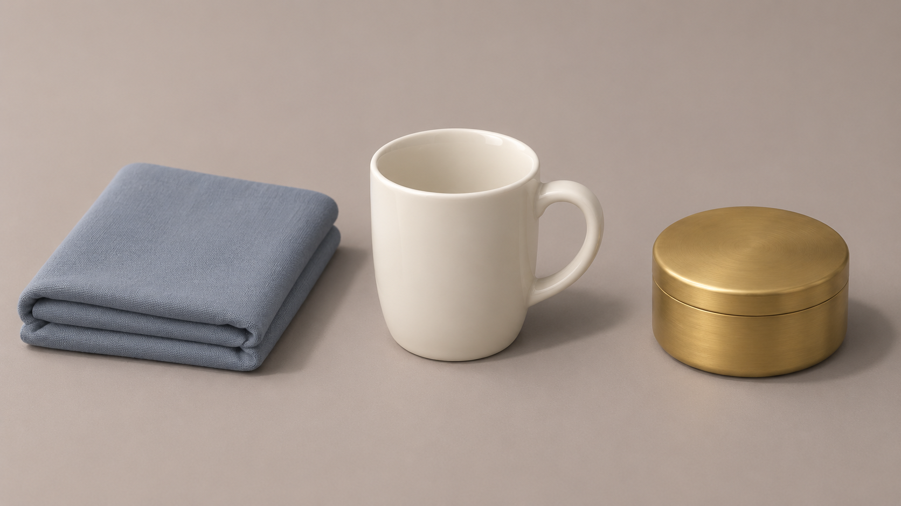
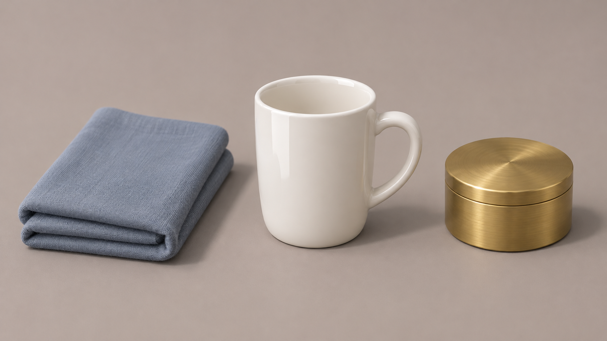

# 11月10日材质对照补测

规则先经PR #93合并到main并回读，再进行本组实际生成。关联原运行 AUDIT-20261110-01 与候选 STYLE-MATERIAL-SEPARATION-20261110-S；当天清晨未生成的报告保留，本文件为后补实测。

结论：两图都能区分布料、瓷器和金属。改写版瓷杯高光与黄铜反射更强，但基线已经完成基本辨识；本组没有证明长材质段更好，也未保持严格相同几何。保留candidate，不转正、不加分。





## 实际检查

| 项目 | 观察与判断 |
|---|---|
| 布料 | 两图都有织纹与折边；基线已清楚，改写未显示确定收益。 |
| 瓷杯 | 改写正面亮带更强，釉面更醒目，但更亮不等于更好看。 |
| 黄铜 | 改写盒盖方向性反射更明显；两图均无明显自发光。 |
| 构图/接触 | 三件物体数量、左右顺序和桌面接触基本满足要求。 |
| 几何 | 杯身、把手与布折有差异，未严格做到只变材质。 |
| 风格 | 都偏干净产品渲染；用户审美认可未获。 |

两次均使用内置image_gen，纯文本，无参考图；实际输出各1672×941，精确模型和种子未暴露。没有视频或声音用途。一次对照且无固定种子，不能报成功率、跨平台有效或因果证明。本组无须重画才能检查材质的明显穿插/悬空缺陷，不为凑成功追加生成。

当前可取的做法：先测简短表达，看到具体材料缺陷时再补对应可见特征；本次只是局部观察，不升级为普遍有效技巧。

## 完整实际输入

基线：

```text
生成一张16:9横向静态材质测试图，无运镜，所有物体保持静止。
暖灰色哑光桌面上，从左到右依次放置：一块折叠整齐的灰蓝色棉布、一只直立的白色上釉瓷杯、一只盖子闭合的未涂漆黄铜圆盒。三个物体彼此留有间隔，不重叠、不接触。杯口、杯把与盒盖完整可见，物体底部自然贴住桌面。
中近景，略俯视的四分之三展示视角，三个物体完整入画并清晰可辨。背景为素净暖灰色，不添加其他物品、人物、文字、Logo或水印。
左前上方一盏大型中性白色柔光照明，三个物体接受同一光源，接触阴影与投影方向一致，亮部保留细节。
三种材质都呈现柔和细腻的质感。
整体风格：柔和的风格化3D静物画面，圆润简洁的造型，克制的细节密度，低饱和蓝、米白与少量黄铜色，干净清楚的轮廓，统一的建模与渲染语言；保留各物体本身的材质差异。
```

改写：

```text
生成一张16:9横向静态材质测试图，无运镜，所有物体保持静止。
暖灰色哑光桌面上，从左到右依次放置：一块折叠整齐的灰蓝色棉布、一只直立的白色上釉瓷杯、一只盖子闭合的未涂漆黄铜圆盒。三个物体彼此留有间隔，不重叠、不接触。杯口、杯把与盒盖完整可见，物体底部自然贴住桌面。
中近景，略俯视的四分之三展示视角，三个物体完整入画并清晰可辨。背景为素净暖灰色，不添加其他物品、人物、文字、Logo或水印。
左前上方一盏大型中性白色柔光照明，三个物体接受同一光源，接触阴影与投影方向一致，亮部保留细节。
棉布：折边有厚度，表面保留细小而克制的棉纤维织纹，明暗过渡柔缓，不出现釉面式的连续亮斑。
瓷杯：表面平整细腻，白色釉层上保留沿杯身曲面延伸的清楚高光，与布料的纤维表面明显不同。
黄铜盒：呈黄铜本色，表面有细微拉丝与随曲面变化的环境明暗反射，仍能看清盒盖边缘；不表现成黄色涂漆、塑料或自行发光的物体。
整体风格：柔和的风格化3D静物画面，圆润简洁的造型，克制的细节密度，低饱和蓝、米白与少量黄铜色，干净清楚的轮廓，统一的建模与渲染语言；保留各物体本身的材质差异。
```

独立配套风格词（已包含在两版整合词中）：

```text
柔和的风格化3D静物画面，圆润简洁的造型，克制的细节密度，低饱和蓝、米白与少量黄铜色，干净清楚的轮廓，统一的建模与渲染语言；保留各物体本身的材质差异。
```

完整参数、尝试时间和评价见 [实测记录](reproduction.json)，逐字输入见 [提示词备份](prompts.json)。
