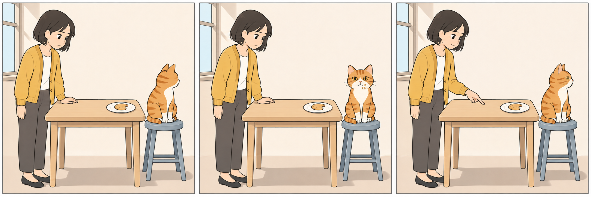
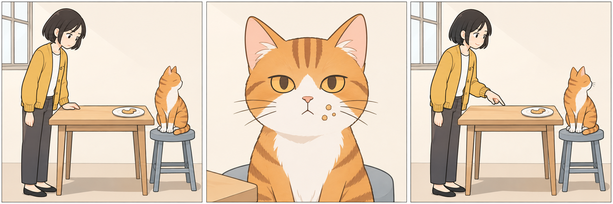

# 每日课标学习｜2026-11-11

用途：原创三格静态故事，检查关键线索取景。不涉及视频制作或原作漫画解读。





改写碎屑更醒目，基线已可读。脸型、桌凳、饼干形状有随机差异，中格画法更细。已有隔离静态试用输入，未形成验证通过的通用方法。

输入：当前内置文生图，无参考上传，分别提交A/B全文；风格已整合。纯静态，不交视频时长、声音或驱动词，不把三格当多图视频输入包。

完整基线：

```text
画一张横向三格无对白故事漫画，三格等大、从左向右阅读，白色格间距和细灰边框。每格都是一个静止瞬间，不表现运镜，不加速度线。没有文字、数字、气泡、拟声词、字幕、标志或水印。

统一风格：简洁二维叙事漫画，稳定的深灰细线，清楚的外轮廓与平涂色块；奶油白背景、芥末黄衣服、橘白猫和少量灰蓝家具。柔和日光统一从画面左上方照入，只有淡而明确的接触阴影。表情克制，比例自然，背景简化但保留桌子与凳子的位置关系；不用写实照片质感、三维塑料光泽、厚重颗粒或装饰性光晕。

固定人物与场景：同一位成年年轻女性，齐下巴黑色短发，芥末黄开衫、白色上衣、深灰长裤和黑色平底鞋；同一只橘色虎斑猫，额头三条深橘纹，白色口鼻、胸口和前爪，琥珀色眼睛。简单厨房里，女性始终在画面左侧，浅木桌在中间，猫坐在右侧的灰蓝矮凳上。白色圆盘放在桌面靠猫一侧，盘中始终只有一块缺了一角的浅棕色饼干。三格的服装、猫花纹、桌凳造型、盘子和饼干状态保持一致，不新增食物或人物。

第一格，全景，平视，完整显示女性、桌子、猫和凳子的接地关系。女性一只手静放在桌边，低头看盘中的饼干，眉头轻皱。猫坐得端正，侧脸朝右，口鼻被侧面角度遮住。背景只保留浅色墙面和左侧窗框。
第二格，全景，平视，完整显示女性、桌子、猫和凳子，沿用第一格的位置和大小。女性仍看着盘子；猫正脸朝向读者，嘴闭合，白色口鼻旁粘着三粒浅棕色饼干屑，表情若无其事。饼干屑是实际附着的小碎屑，不放大成装饰，不加箭头或光圈。
第三格，全景，平视，保持左右站位。女性嘴角略扬，视线落在猫脸上，右手食指朝向桌面的盘子，双脚稳稳站地。猫仍端坐在凳上，头偏向右侧、避开女性的目光，前爪稳放凳面。盘中的饼干和其他物件不变。
```

完整改写：

```text
画一张横向三格无对白故事漫画，三格等大、从左向右阅读，白色格间距和细灰边框。每格都是一个静止瞬间，不表现运镜，不加速度线。没有文字、数字、气泡、拟声词、字幕、标志或水印。

统一风格：简洁二维叙事漫画，稳定的深灰细线，清楚的外轮廓与平涂色块；奶油白背景、芥末黄衣服、橘白猫和少量灰蓝家具。柔和日光统一从画面左上方照入，只有淡而明确的接触阴影。表情克制，比例自然，背景简化但保留桌子与凳子的位置关系；不用写实照片质感、三维塑料光泽、厚重颗粒或装饰性光晕。

固定人物与场景：同一位成年年轻女性，齐下巴黑色短发，芥末黄开衫、白色上衣、深灰长裤和黑色平底鞋；同一只橘色虎斑猫，额头三条深橘纹，白色口鼻、胸口和前爪，琥珀色眼睛。简单厨房里，女性始终在画面左侧，浅木桌在中间，猫坐在右侧的灰蓝矮凳上。白色圆盘放在桌面靠猫一侧，盘中始终只有一块缺了一角的浅棕色饼干。三格的服装、猫花纹、桌凳造型、盘子和饼干状态保持一致，不新增食物或人物。

第一格，全景，平视，完整显示女性、桌子、猫和凳子的接地关系。女性一只手静放在桌边，低头看盘中的饼干，眉头轻皱。猫坐得端正，侧脸朝右，口鼻被侧面角度遮住。背景只保留浅色墙面和左侧窗框。
第二格，猫脸近景，平视，与前后格同侧观察。只呈现同一只猫的头部和上胸，猫脸占本格大部分面积，正脸朝向读者，嘴闭合，白色口鼻旁粘着三粒浅棕色饼干屑，表情若无其事。保留下缘少量灰蓝凳面和左下角桌边，提示仍在同一位置；女性位于画外，状态仍是看着盘子。景别改变，猫的真实体型、花纹和碎屑大小不变；饼干屑因取景靠近而清楚，不加箭头或光圈。
第三格，全景，平视，保持左右站位。女性嘴角略扬，视线落在猫脸上，右手食指朝向桌面的盘子，双脚稳稳站地。猫仍端坐在凳上，头偏向右侧、避开女性的目光，前爪稳放凳面。盘中的饼干和其他物件不变。
```

独立风格词：

```text
简洁二维叙事漫画，稳定的深灰细线，清楚的外轮廓与平涂色块；奶油白背景、芥末黄衣服、橘白猫和少量灰蓝家具。柔和日光统一从画面左上方照入，只有淡而明确的接触阴影。表情克制，比例自然，背景简化但保留桌子与凳子的位置关系；不用写实照片质感、三维塑料光泽、厚重颗粒或装饰性光晕。
```

## 1. 结论

北京时间2026-11-11，AUDIT-20261111-01，A周三故事课。3次顺序技巧查询成功，独立资讯1次，额外0；查询前预留已main回读。实际图2张，视频0。**证据不足，今日不入库。**局部线索更醒目，缺独立效果证据、理解盲测和严格同形控制。

## 2. 候选与时效

CLUE-FRAMING-20261111-S，三格故事的关键线索取景。主归漫画，资产检查静态状态，影视仅迁移观看重点。当前内置image_gen.imagegen文生图，精确模型/种子/采样器未知。

- S1 [Zooming in on visual narrative comprehension](https://link.springer.com/content/pdf/10.3758/s13421-020-01101-w.pdf)，Tom Foulsham、Neil Cohn，S级，发布：2020-10-06。读取范围：出版方PDF摘要与前部实验设计；第三轮返回讨论/局限段，未逐页通读。
- S2 [The Attentional Theory of Cinematic Continuity](https://ualresearchonline.arts.ac.uk/id/eprint/21187/)，Tim J. Smith，S级，发布：2012-06-01。读取范围：作者机构题录与出版方摘要，未逐页通读27页。
- S3 [Zooming in on the cognitive neuroscience of visual narrative](https://visuallanguagelab.com/P/2020.BC.NCTF.pdf)，Neil Cohn、Tom Foulsham，S级，发布：2020年，具体发布日期未知；接受日不冒作发布日期。读取范围：作者站论文PDF摘要及引言，未逐页复核统计。

证据核对/实际出图2026-11-11；整体验证通过日期为空。候选复审11月13日，方法复核2027-05-11，入口复核2026-12-11；理论无固定期，不拿候选复审日当active有效期。四维重合近似87.5%（步骤0.5/场景1/目标1/限制1），依据现行关键细节可读与不机械套景别原则；仅补充候选，不建新Skill。这不是作品质量分。

## 3. 证据矩阵/独立性

|核心主张|支持|反证/限制|置信度与缺口|
|---|---|---|---|
|按线索取景，同时保留必要上下文|S1, S2|S1讨论, S3|中（一般叙事原理）；漫画实验与电影理论，不等于模型指令保证。|
|仅中格近景让本组碎屑更醒目|本次两张实图|基线已可见, 几何与画法存在随机差异|中（本组现象）；无固定种子、无读者盲测，不能推理解率。|
|每格都近景会更好理解||S1讨论, S3|低，不采纳；视野变窄可能增加整合负担。|

S1/S3同作者同研究脉络，不拆票。S2不同作者与年代，只作电影理论交叉背景，未验证本中文提示词。没有找到独立A/B效果来源；不能靠多篇S论文自动补齐效果票。限量来源片段、读取范围、保存时间与SHA在[sources.json](sources.json)。

## 4. 反证与真实复现

Q3包含limitations/failure，命中S1讨论中关于宽构图/上下文的限制；未找到本中文提示词直接弃用报告，不等于证明无失败。S3由Q1已知链接打开，提示连续窄取景可能增加整合负担，不冒写成Q3独立命中。

环境：当前内置文生图，无参考，不透明背景。A/B各一次，均2172×724；模型/种子未暴露。实际时间、文件SHA、输入见[reproduction.json](reproduction.json)。只有第二格取景文字不同，但两个独立生成结果并非像素配准。

预期是线索更醒目并保持关系和外形。实际中格碎屑更醒目，左右站位和接触基本保持；基线也能看见。脸型、家具、饼干缺口和画法差异保留，严格同形控制未过。无盲测、重复统计、视频或声音验证。

最小复现：同一内置入口原样分别提交两份全文，无参考；保留全部输出，按线索、空间、身份/道具、风格逐项核对。若线索消失、换身份、空间联系断裂或悬空即失败。本组未见阻断检查的结构/接触大错，定向修正0次；不为凑优势继续刷图。

三套覆盖：[cross-skill-transfer.json](cross-skill-transfer.json)。漫画只验原创格序/线索，原作与气泡未测；影视仅静态设计，动作/剪辑/声画未测；资产可见身份/支撑基本保持，严格外形和独立多视资产未过。

## 5. 七问反方自检

1. 最可能错在哪里？ 把更醒目等同于理解更好；基线已可读，本次没有读者盲测。
2. 是否过时、弃用或已有替代？ 2012/2020论文作原理，不冒充2026模型测评；模型/入口改变需复核。
3. 来源是否互抄／同源？ S1/S3同作者研究脉络；S2不同作者但只是电影背景，缺独立A/B效果来源。
4. 是否仅特定版本、付费或地区有效？ 只用当前内置额度，精确模型/种子未暴露；其他平台、费用和地区未测。
5. 有没有更简单、更优替代？ 基线已清楚时保留全景；也可先减遮挡与干扰，后一替代本次未测。
6. 复现最可能失败在哪里？ 猫花纹/饼干形状漂移，近景画法变细，空间联系被裁掉；已见跨采样形状和画法差异。
7. 是否强行凑数写入？ 只测一个课表相关的已有原则，不新建Skill，不转正、不自动加分。

## 6. 状态三票

candidate；证据票未过，缺独立效果来源；整体复现票未过，局部显著性不等于理解增益与严格一致性；人类票未收到。未解决的是证据缺口，“所有格近景都更好”明确不采纳。不标observing或active。

不虚构分数/成功率。唯一信用主账余额7、本次到账0；只登记完整无入库审计拟奖+3，待周五人类核验，不新增名额、不按出图数量额外奖励。

## 7. 版本与保存范围

影视V1.4.9、资产V1.4.9、漫画V1.3.9保持。记录、实图、完整输入、来源、索引/目录元数据、当天预算和独立资讯保存，不更新正式方法。

预留PR95，main b92d362e9172659873ded3ffd637e450eb7dfb59，4文件回读；起点备份backup/pre-audit-20261111=638bbc0bf5bd17dc412649046ebe4392180d69e0，完成阶段backup/pre-audit-20261111-complete=b92d362e9172659873ded3ffd637e450eb7dfb59。昨日图片补充PR94先合并回读9文件，未重跑昨日查询。

本目录保存候选/图/词；独立资讯另存影视audit/news/2026-11-11。检查见[validation.json](validation.json)，实际PR、main逐文件结果和本地恢复提交见[save-receipt.json](save-receipt.json)。提交前不自证完成；以真实回执为准。

## 8. 原始检索留痕

|名额|实际开始（Asia/Shanghai）|原查询|结果|
|---|---|---|---|
|1|2026-11-11T04:08:01.172000+08:00|`Neil Cohn visual narrative framing panels attention close up comprehension`|成功；命中Foulsham与Cohn的视觉叙事取景实验及Cohn框架论文，选定关键线索取景这一项。|
|2|2026-11-11T04:10:57.573000+08:00|`Tim Smith attentional theory cinematic continuity establishing shot eye movements`|成功；命中Tim J. Smith关于连续性与注意的独立理论；适用电影剪辑，未验证本次漫画提示词。|
|3|2026-11-11T04:11:08.983000+08:00|`visual narrative close up panels comprehension missing context limitations failure`|成功；命中同一取景论文的反面边界：删去关键信息或上下文可能增加处理负担；不能把近景变成固定配方。|
|4|2026-11-11T04:11:31.180000+08:00|`AI model tools official release November 10 2026`|成功；命中Google官方Carbon发布索引、n8n Nod线索和多条二手/重复消息；后续直接打开已知页面核验，未增加查询。|

三次技巧system1无时限；资讯system1最近2天。标题、URL、ref和实际起止时间在search-1.json至search-4.json；已知链接打开不另增查询，失败打开如实记录。prompts/、images/与reproduction.json为同份实测输入输出。快照SHA在sources.json；不镜像论文全文。

另交[独立AI资讯](../../skills/script-video-shot-director/references/audit/news/2026-11-11/report.md)：Nod已核验官方正文，Carbon仅官方索引部分核验，两者未安装或实测。
