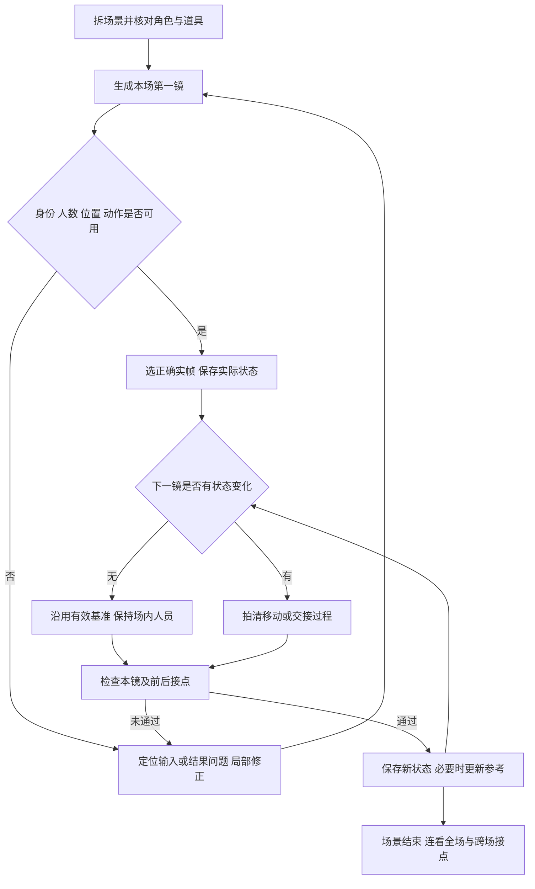

# 场景连续性与逐镜反馈

状态：项目实践总结；已在本次制作中采用，用户认可流程。效果边界见案例，不承诺跨模型或跨软件效果相同。

适用：多个生成片段要组成同一场戏，人物位置、人数、动作和道具需要前后相接。前提是目标工具能接收可检查的视觉参考或其他等效约束；只接受文字的平台不能视为具备同等能力。

## 核心变化

整集剧本、对白和预算可以提前规划。同一场景后续镜头的提交，应等待前一镜出现可用结果并完成必要检查。文本中的计划状态与成片中的实际状态分别保存，不能把“要求坐下”记录成“已经坐下”。

图中“通过”指本次已执行的具体检查；没有听审和口型复核时，不能称为最终验收。

## 三类状态与参考

1. **场景状态**：固定门、窗、桌、床等空间锚点；出入口；场内全员名单；每人的位置、站坐卧、身体与视线方向、服装、口罩、伤势及持物。分别记录全场人数与当前镜头可见人数。
2. **实际参考**：已检查画面的来源分镜、任务版本、帧时间、素材标识与用途。有效帧不一定是最后一帧。多人参考可用多个视角，但不能无说明地同时保留同一人的旧站姿与新坐姿。
3. **当前变化**：本镜主要改变什么；动作起点、过程、接触与结果；上一镜结束与本镜开始怎样接上。检查后更新实际状态，保留计划与结果的差别。

固定站位的对话可持续使用同一可靠基准；发生走动、落座、起身、换手、入场或离场时，先看到并检查变化，再引用变化后的画面。换景后建立新空间基准，同时保留仍然连续的服装、伤势、持物与故事时间。

人物没说话、被遮挡或在画外，都不等于离场。没有实际离场依据时保留其身份与原位；这不要求把所有人放进每个特写。群像不能把单独引用的主角再次算进去。

## 逐镜运行与恢复

建议保存“草稿→可提交→已提交→已有结果→检查后可续拍→参考已就绪”，以及“阻塞／待修改”。这些是记录字段，不要求使用某种软件实现。

- 同一连续性链条只让参考已就绪的节点进入提交；与它没有人物状态、持物或空间承接依赖的场景可以独立推进。
- 提交后立即保存平台任务标识。超时或中断后先查询现有任务，不能因没收到回复就重复支付。
- 每次尝试保留输入版本、素材版本、报价、任务与检查结论。恢复工作先对账当前选中历史，不能默认最新一次最好。
- 前镜或参考改变时，把依赖它的后镜标为“需要复查”；先检查影响范围，不自动付费重做全部下游。
- 失败时先判断输入冲突、错误参考、模型偏差或工具未保存。重新描述同一个矛盾并反复生成，通常不能解决根因。
- 超出当前有效预算、关键身份未解决、参考错误或工具能力不足时停止依赖部分，保存具体原因与可继续的独立工作。

## 画面有戏，同时空间清楚

对白注明说话人、听话人、目光对象和双方位置。按“刺激→接收→反应→回应”选择中近景、近景、过肩或有意义的局部，而非每句机械切镜。说话声可延续在听者反应画面上，声音归属保持原人。

复杂动作尽量拆成清楚的主要变化，拍到起点、接触和结果；反应镜头继续沿用该角色真实姿态与道具。气口来自实际呼吸、反应或完成的离开动作，时长按剧种和情绪决定，不用黑帧或冻结充数。

## 检查与补救顺序

先检查身份、人数与空间，再检查动作、道具、视线、对白归属和节奏。单镜检查后还要检查接点；修正后重新检查前后两处接点，跨集同场同样处理。

错误人物、分身、关键台词错人、重要动作断裂或错误基准帧，不能继续当下游参考。可剪辑的问题必须有真实可用覆盖与明确裁点，不能只写“后期处理”。

优先使用现有有效片段，在保留对白和因果前提下裁剪或覆盖；必要时补最小片段。保留原版与补版及结果，不把每次新生成当改善。实际连续播放与听审另列：抽帧、转写和任务完成都不能代替音画终审。

## 更换软件时保留什么

保留场景状态、参考来源、依赖顺序、任务记录、检查条件与费用记录；替换素材上传、绑定、提交、查询、裁剪及导出操作。图片引用、首尾帧、视频参考与姿态控制是不同约束方式，先做低成本能力验证，不能仅凭功能名称认定等效。

如果新工具不能携带视觉参考，记录能力缺口并调整方案；不要宣称已按同等连续性流程完成。历史项目报价、单段上限与预算均不能直接搬过去。
